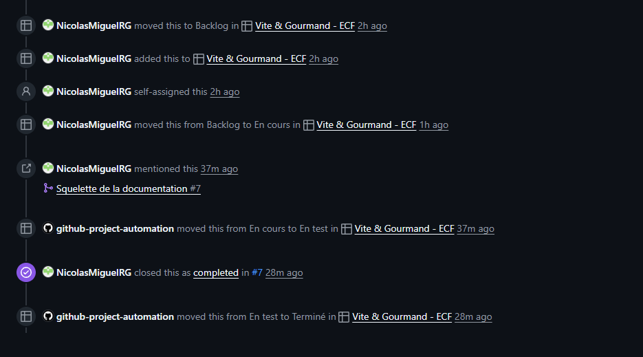
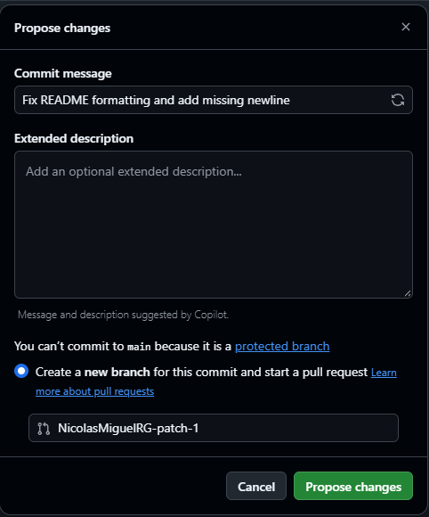

# Gestion de projet 

## Méthode 

Le projet est mené seul, avec un temps disponible irrégulier.
Des sprints de durée fixe n'étaient donc pas adaptés. 
J'utilise un modèle hybride, le **Scrumban** :
- **de Scrum** : un backlog priorisé, des jalons et une rétrospective à la fin de chaque jalon ;
- **de Kanban** : un flux tiré (je prends la carte suivante en haut du Backlog quand j'ai du temps) et une limite de travail en cours. 

## Outil : GitHub Projects 

Tableau de suivi : [Vite & Gourmand - ECF](https://github.com/users/NicolasMiguelRG/projects/2/views/1)

J'ai choisi GitHub Projects car les cartes sont des issues du dépôt : chaque carte est reliée à sa branche, à ses commits et à sa pull request, ce qui assure la traçabilité du travail. 

| Colonne | Rôle |
|---|---|
| Backlog | Toutes les cartes à faire, triées par priorité |
| En cours | Cartes en cours de construction (2 maximum) |
| En test | Cartes construites, en cours de vérification |
| Terminé | Cartes testées et fusionnées dans `dev` |

Champs personnalisés : 
- **Priorité** : P0 (priorité absolue), P1 (important), P2 (bonus)
- **Jalon** : J0 à J5
- **Catégorie** : Conception, Fonctionnalité, Documentation, DevOps, Bug
- **Taille** : S (moins de 2h), M (une demi-journée), L (une journée ou plus, à découper si possible)

Automatisations :
- une issue ajoutée au projet arrive dans le Backlog ;
- l'ouverture d'une pull request liée à une issue (mot-clé « Closes #X ») fait passer la carte en En test ;
- la fusion de la pull request dans `dev` ferme l'issue et fait passer la carte en Terminé ;
- une carte déplacée manuellement en Terminé ferme automatiquement son issue.

*Historique de l'issue #4 : passage automatique en En test à l'ouverture de la pull request #7, puis fermeture et passage en Terminé à sa fusion.*

### User stories : les cartes font référence

Les fonctionnalités du jalon J4 sont décrites sous forme de user stories, une carte par story.
Chaque carte contient la user story, ses critères d'acceptation, ses dépendances (« Dépend de : #X ») et les règles de gestion concernées.

**Les cartes sont la source de vérité** : c'est la carte qui fait foi, et non une copie dans la documentation.
Une même information écrite à deux endroits finit toujours par diverger ; en la gardant sur la carte, elle reste reliée à la branche, aux commits et à la pull request qui la réalisent.
La documentation n'en contient qu'un tableau récapitulatif, dans le [cahier des charges](02-cahier-des-charges.md#user-stories).

Pour que toutes les cartes aient la même structure, j'utilise un modèle de carte (`.github/ISSUE_TEMPLATE/user-story.md`) :
- le titre commence par « US · », pour distinguer les user stories des autres cartes (tâches techniques, documentation) ;
- les critères communs à toutes les user stories (affichage sur ordinateur et mobile, accessibilité, contrôles côté serveur, tests, documentation) y sont écrits une seule fois.

Une vue « Table » du tableau, filtrée sur le jalon J4, affiche toutes les user stories avec leur statut, leur priorité et leur taille.

## Jalons 

| Jalon | Contenu | Date cible | Date réelle |
|---|---|---|---|
| J0 - Mise en place | Dépôt, branches, tableau, documentation | 8 novembre | 31 octobre |
| J1 - Analyse & conception | Cahier des charges, UML, MCD, choix techniques | 15 novembre | 14 novembre |
| J2 - Maquettes & charte | Wireframes, mockups, palette, police | 22 novembre | |
| J3 - Socle technique | Environnement, bases de données, CI/CD, premier déploiement | 29 novembre | |
| J4 - Fonctionnalités | Développement par fonctionnalité complète | 20 décembre | |
| J5 - Finalisation | RGAA, sécurité, tests, manuel, charte PDF, copie | 31 décembre | |

## Règle de passage d'un jalon à l'autre 

Je considère un jalon terminé quand toutes ses cartes P0 sont terminées.
Les cartes P1 et P2 restantes sont reportées dans le Backlog. 
À l'exception du cas où une carte du jalon suivant dépend de l'une d'elles : dans ce cas, je la traite en priorité.
Ces dépendances sont notées dans la description des cartes sous la forme « Dépend de : #X ».

## Definition of Done 

Une carte passe en Terminé lorsque : 
- le code est testé ;
- la pull request est fusionnée dans `dev` ;
- les règles d'accessibilité de base sont respectées ;
- la documentation est mise à jour si nécessaire ;
- toute recherche sur un site anglophone ayant servi est notée dans `recherches-anglophones.md`.

## Workflow Git

- `dev` : branche par défaut du dépôt, branche d'intégration du code en cours de construction et à tester
- `main` : code stable, prêt au déploiement, protégé (aucun envoi direct, fusion uniquement par pull request)
- une branche par fonctionnalité, créée depuis `dev`, puis fusionnée dans `dev` après test
- `dev` est fusionnée dans `main` une fois testée
- chaque fusion de `dev` vers `main` donne lieu à une release GitHub versionnée (v0.1, v0.2...), qui liste les pull requests incluses et constitue l'historique des mises en production

`dev` est la branche par défaut car c'est sur elle qu'arrive tout le travail :
les mots-clés de liaison (« Closes #X ») ne fonctionnent que pour une pull request
qui cible la branche par défaut.

*Tentative de modification directe de `main` : GitHub impose de passer par une nouvelle branche et une pull request.*

Convention de nommage des branches : 
- `feature/...` : fonctionnalité
- `docs/...` : documentation 
- `fix/...` : correction de bug

## Rétrospectives

### J0 – Mise en place (cible : 8 novembre · réel : 31 octobre)

**Ce qui a fonctionné**

Tout le jalon s'est déroulé comme prévu et a été terminé une semaine avant la date cible.
L'organisation du projet a été préparée avec l'aide de Claude (IA), complétée par la lecture
de la documentation de GitHub Projects.

**Difficultés**

J'avais configuré l'automatisation de mes cartes à partir des pull requests, avec `main` comme
branche par défaut. Or mes fonctionnalités sont créées à partir de `dev`, et leurs pull requests
sont fusionnées dans `dev`. Le mot-clé « Closes #X » ne fonctionnant que pour les pull requests
qui ciblent la branche par défaut, l'automatisation n'aurait jamais fonctionné.

**Ajustements**

- J'ai fait de `dev` la branche par défaut, et modifié la règle de protection pour qu'elle cible
  `main` par son nom.
- J'ai décidé de tracer les mises en production par des releases GitHub (v0.x) à chaque fusion
  de `dev` vers `main`. Je déciderai au J3 si leur création est automatisée.

**Pour la suite**

Je conserve la même méthode pour les prochains jalons.

### J1 – Analyse & conception (cible : 15 novembre · réel : 14 novembre)

**Ce qui a fonctionné**

Le jalon s'est bien déroulé et a été terminé un jour avant la date cible.
Cette avance s'explique en partie par un temps disponible plus important que prévu
pendant ces deux semaines, et pas seulement par une meilleure vitesse de travail.

**Difficultés**

Chaque étape de la conception a fait apparaître des oublis ou des incohérences dans les
documents déjà terminés (cahier des charges, diagrammes de cas d'utilisation…). Chaque
modification entraînait donc des corrections en cascade sur plusieurs documents.
La rédaction de la documentation a aussi été la partie la plus difficile pour moi :
c'est mon point faible, et ce jalon en demandait beaucoup.

**Ajustements**

- J'ai réalisé le modèle conceptuel de données (#14) avant le diagramme de séquence (#13),
  car le diagramme de séquence montre les échanges avec la base de données : il fallait
  d'abord savoir quelles données elle contient.
- J'ai passé la carte « Mettre en place le CI/CD avec GitHub Actions » (#6) de P1 à P0,
  car la documentation du déploiement (#73), en P0, dépend d'elle.

**Cartes ajoutées pendant le jalon**

| Carte | Jalon | Justification |
|---|---|---|
| #20 Mettre à jour la documentation de conception après les user stories | J1 · P0 | Les user stories ont fait apparaître des règles et des cas absents du cahier des charges et des diagrammes. Il fallait les mettre à jour avant le MCD, pour le construire à partir d'une source d'informations sûre. |
| #17 Documenter la structure du dépôt | J3 · P2 | Les images de la documentation ont été réorganisées en un sous-dossier par fichier pendant la #11 : cette convention doit être documentée. |
| #22 à #24 Tâches techniques (gabarit commun, journalisation des erreurs, base NoSQL) | J3 · P0 | Nécessaires à plusieurs user stories, mais ce ne sont pas des fonctionnalités visibles par l'utilisateur. |
| #25 à #65 User stories | J4 | Résultat prévu de la #12 : une carte par user story. |
| #68 Imprimer le bon de livraison d'une commande | J4 · P2 | Idée apparue pendant le MCD, pour que le livreur dispose des coordonnées du client. |
| #72 et #73 Documentation de l'environnement et du déploiement | J3 · P0 | Documents exigés par l'énoncé, qui n'étaient pas encore prévus dans le Backlog. |
| #74 Rédiger la rétrospective du J1 | J1 · P1 | Bilan du jalon, comme la #8 pour le J0. |

**Pour la suite**

Je maintiens les dates cibles des jalons suivants. L'avance du J1 venant en partie d'un temps
disponible plus important que prévu, je ne compte pas sur elle pour la suite. Si besoin, le J2
(maquettes et charte) et le J3 (socle technique) peuvent avancer en parallèle, car les maquettes
ne bloquent pas l'installation technique. Je vérifierai le rythme réel à la rétrospective du J2
et j'ajusterai le planning si nécessaire.

## Sources

- [Planning and tracking with Projects](https://docs.github.com/en/issues/planning-and-tracking-with-projects)
- [Creating a project](https://docs.github.com/en/issues/planning-and-tracking-with-projects/creating-projects/creating-a-project)
- [Customizing the board layout](https://docs.github.com/en/issues/planning-and-tracking-with-projects/customizing-views-in-your-project/customizing-the-board-layout)
- [Using the built-in automations](https://docs.github.com/en/issues/planning-and-tracking-with-projects/automating-your-project/using-the-built-in-automations)
- [Managing visibility of your projects](https://docs.github.com/en/issues/planning-and-tracking-with-projects/managing-your-project/managing-visibility-of-your-projects)
- [Creating rulesets for a repository](https://docs.github.com/en/repositories/configuring-branches-and-merges-in-your-repository/managing-rulesets/creating-rulesets-for-a-repository)