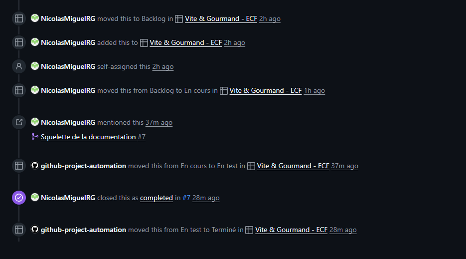
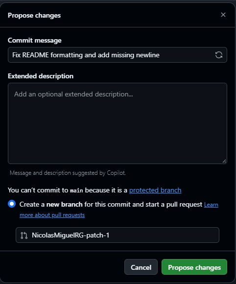

# Gestion de projet 

## Méthode 

Le projet est mené seul, avec un temps disponible irrégulier.
Des sprints de durée fixe n'étaient donc pas adaptés. 
J'utilise un modèle hybride, le **Scrumban** :
- **de Scrum** : un backlog priorisé, des jalons et une rétrospective à la fin de chaque jalon ;
- **de Kanban** : un flux tiré (je prends la carte suivante en haut du Backlog quand j'ai du temps) et une limite de travail en cours. 

## Outil : GitHub Projects 

Tableau de suivi : [Vite & Gourmand - ECF](https://github.com/users/NicolasMiguelRG/projects/2/views/1)

J'ai choisi GitHub Projects car les cartes sont des issues du dépôt : chaque carte est reliée à sa branche, à ses commits et à sa pull request, ce qui assure la traçabilité du travail. 

| Colonne | Rôle |
|---|---|
| Backlog | Toutes les cartes à faire, triées par priorité |
| En cours | Cartes en cours de construction (2 maximum) |
| En test | Cartes construites, en cours de vérification |
| Terminé | Cartes testées et fusionnées dans `dev` |

Champs personnalisés : 
- **Priorité** : P0 (Priorité absolue), P1 (important), P2 (bonus)
- **Jalon** : J0 à J5
- **Catégorie** : Conception, Fonctionnalité, Documentation, DevOps, Bug
- **Taille** : S (moins de 2h), M (une demi-journée), L (une journée ou plus, à découper si possible)

Automatisations :
- une issue ajoutée au projet arrive dans le Backlog ;
- l'ouverture d'une pull request liée à une issue (mot-clé « Closes #X ») fait passer la carte en En test ;
- la fusion de la pull request dans `dev` ferme l'issue et fait passer la carte en Terminé ;
- une carte déplacée manuellement en Terminé ferme automatiquement son issue.

*Historique de l'issue #4 : passage automatique en En test à l'ouverture de la pull request #7, puis fermeture et passage en Terminé à sa fusion.*

## Jalons 

| Jalon | Contenu | Date cible | Date réelle |
|---|---|---|---|
| J0 - Mise en place | Dépôt, branches, tableau, documentation | 8 novembre | 31 octobre |
| J1 - Analyse & conception | Cahier des charges, UML, MCD, choix techniques | 15 novembre | |
| J2 - Maquettes & charte | Wireframes, mockups, palette, police | 22 novembre | |
| J3 - Socle technique | Environnement, bases de données, CI/CD, premier déploiement | 29 novembre | |
| J4 - Fonctionnalités | Développement par fonctionnalité complète | 20 décembre | |
| J5 - Finalisation | RGAA, sécurité, tests, manuel, charte PDF, copie | 31 décembre | |

## Règle de passage d'un jalon à l'autre 

Je considère un jalon terminé quand toutes ses cartes P0 sont terminées.
Les cartes P1 et P2 restantes sont reportées dans le Backlog. 
À l'exception du cas où une carte du jalon suivant dépend de l'une d'elles : dans ce cas, je la traite en priorité.
Ces dépendances sont notées dans la description des cartes sous la forme « Dépend de : #X ».

## Definition of Done 

Une carte passe en Terminé lorsque : 
- le code est testé ;
- la pull request est fusionnée dans `dev` ;
- les règles d'accessibilité de base sont respectées ;
- la documentation est mise à jour si nécessaire ;
- toute recherche sur un site anglophone ayant servi est notée dans `recherches-anglophones.md`.

## Workflow Git

- `dev` : branche par défaut du dépôt, branche d'intégration du code en cours de construction et à tester
- `main` : code stable, prêt au déploiement, protégé (aucun envoi direct, fusion uniquement par pull request)
- une branche par fonctionnalité, créée depuis `dev`, puis fusionnée dans `dev` après test
- `dev` est fusionnée dans `main` une fois testée
- chaque fusion de `dev` vers `main` donne lieu à une release GitHub versionnée (v0.1, v0.2...), qui liste les pull requests incluses et constitue l'historique des mises en production

`dev` est la branche par défaut car c'est sur elle qu'arrive tout le travail :
les mots-clés de liaison (« Closes #X ») ne fonctionnent que pour une pull request
qui cible la branche par défaut.

*Tentative de modification directe de `main` : GitHub impose de passer par une nouvelle branche et une pull request.*

Convention de nommage des branches : 
- `feature/...` : fonctionnalité
- `docs/...` : documentation 
- `fix/...` : correction de bug

## Rétrospectives

### J0 – Mise en place (cible : 8 novembre · réel : 31 octobre)

**Ce qui a fonctionné**
Tout le jalon s'est déroulé comme prévu et a été terminé une semaine avant la date cible.
L'organisation du projet a été préparée avec l'aide de Claude (IA), complétée par la lecture
de la documentation de GitHub Projects.

**Difficultés**
J'avais configuré l'automatisation de mes cartes à partir des pull requests, avec `main` comme
branche par défaut. Or mes fonctionnalités sont créées à partir de `dev`, et leurs pull requests
sont fusionnées dans `dev`. Le mot-clé « Closes #X » ne fonctionnant que pour les pull requests
qui ciblent la branche par défaut, l'automatisation n'aurait jamais fonctionné.

**Ajustements**
- J'ai fait de `dev` la branche par défaut, et modifié la règle de protection pour qu'elle cible
  `main` par son nom.
- J'ai décidé de tracer les mises en production par des releases GitHub (v0.x) à chaque fusion
  de `dev` vers `main`. Je déciderai au J3 si leur création est automatisée.

**Pour la suite**
Je conserve la même méthode pour les prochains jalons.

## Sources

- [Planning and tracking with Projects](https://docs.github.com/en/issues/planning-and-tracking-with-projects)
- [Creating a project](https://docs.github.com/en/issues/planning-and-tracking-with-projects/creating-projects/creating-a-project)
- [Customizing the board layout](https://docs.github.com/en/issues/planning-and-tracking-with-projects/customizing-views-in-your-project/customizing-the-board-layout)
- [Using the built-in automations](https://docs.github.com/en/issues/planning-and-tracking-with-projects/automating-your-project/using-the-built-in-automations)
- [Managing visibility of your projects](https://docs.github.com/en/issues/planning-and-tracking-with-projects/managing-your-project/managing-visibility-of-your-projects)
- [Creating rulesets for a repository](https://docs.github.com/en/repositories/configuring-branches-and-merges-in-your-repository/managing-rulesets/creating-rulesets-for-a-repository)