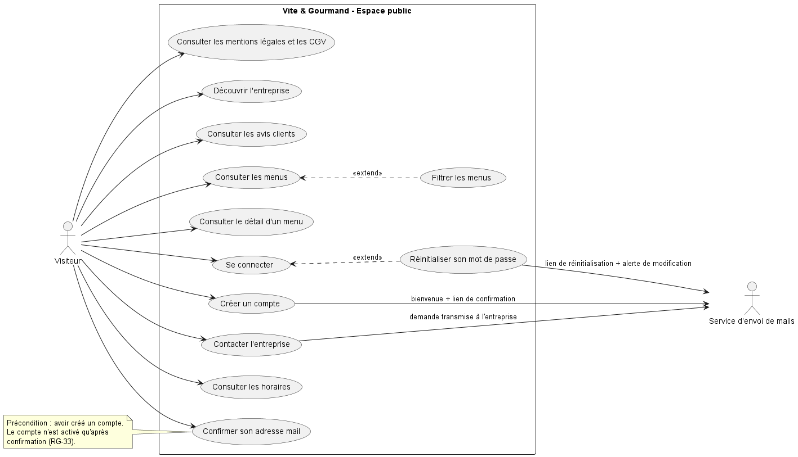
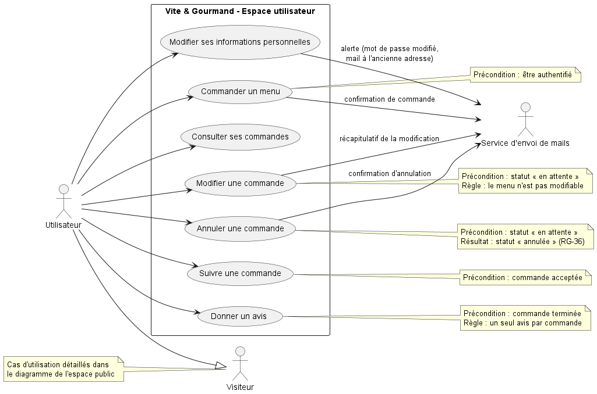
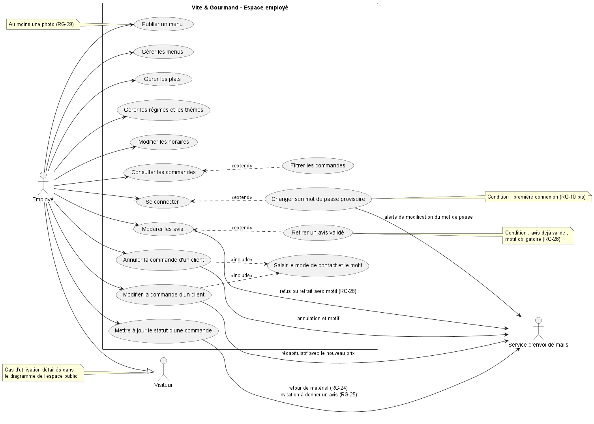
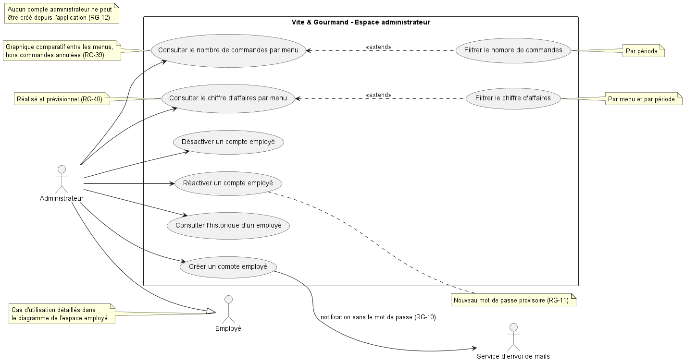

# Conception

## Diagramme de cas d'utilisation

### Démarche

Les diagrammes de cas d'utilisation sont construits à partir des spécifications fonctionnelles et des règles de gestion du [cahier des charges](02-cahier-des-charges.md).

Ils sont réalisés avec **PlantUML**, via l'extension VS Code, en rendu local :
- le diagramme est décrit en texte (fichiers `.puml`), ce qui permet de le versionner avec Git et de suivre chaque modification dans les pull requests ;
- la même syntaxe servira pour les diagrammes de séquence ;
- le rendu local évite d'envoyer le contenu des diagrammes à un serveur externe.

Les fichiers sources se trouvent dans `docs/diagrammes/`, et les images exportées dans `docs/images/conception/`.

### Découpage

L'application compte une quarantaine de cas d'utilisation. Pour rester lisible, la modélisation est découpée en **un diagramme par espace** : public, utilisateur, employé et administrateur.

### Acteurs

| Acteur | Type | Hérite de |
| --- | --- | --- |
| Visiteur | Principal | — |
| Utilisateur | Principal | Visiteur |
| Employé | Principal | Visiteur |
| Administrateur | Principal | Employé |
| Service d'envoi de mails | Secondaire | — |

Le service d'envoi de mails est un acteur secondaire : il ne déclenche aucun cas d'utilisation, c'est l'application qui le sollicite pour envoyer les mails prévus par le cahier des charges.

L'héritage évite de répéter les cas d'utilisation : un acteur enfant peut réaliser tous les cas de son parent. Dans chaque diagramme, l'acteur parent est représenté avec une note renvoyant au diagramme qui détaille ses cas. Ce choix implique un compromis assumé : l'utilisateur et l'employé héritent aussi de « Créer un compte », qui n'a plus d'intérêt une fois connecté.

### Conventions de lecture

- **Colonne de gauche** : les cas déclenchés directement par l'acteur.
- **Colonne de droite** : les cas qui en dépendent (`<<include>>` et `<<extend>>`).
- **`<<include>>`** : le cas inclus est exécuté à chaque fois (obligatoire).
- **`<<extend>>`** : le cas qui étend ne s'exécute que sous une condition.
- **Notes** : préconditions et règles, avec la référence de la règle de gestion (RG-xx).
- **Étiquettes vers le service de mails** : le mail envoyé lors du cas.

L'authentification n'est pas représentée par un `<<include>>` : c'est une **précondition** d'accès aux espaces, pas une étape d'un cas d'utilisation. 

### Espace public

Le visiteur, non authentifié, découvre l'entreprise et consulte les avis clients validés depuis la page d'accueil. Il accède à l'ensemble des menus, qu'il peut filtrer dynamiquement, et peut consulter le détail de chacun. Il peut créer un compte, puis confirmer son adresse mail grâce au lien reçu : le compte n'est activé qu'après cette confirmation. Il peut se connecter et, en cas d'oubli, réinitialiser son mot de passe. Il peut également contacter l'entreprise via un formulaire, et consulter les horaires d'ouverture ainsi que les mentions légales et les conditions générales de vente. Le service d'envoi de mails intervient comme acteur secondaire lors de la création de compte (mail de bienvenue contenant le lien de confirmation), de la réinitialisation du mot de passe (lien de réinitialisation, puis alerte de modification) et de la prise de contact (transmission de la demande à l'entreprise).

### Espace utilisateur

L'utilisateur est un visiteur authentifié : il hérite de l'ensemble des cas d'utilisation de l'espace public. Une fois connecté, il peut commander un menu, depuis la vue détaillée d'un menu ou directement depuis la page de commande ; une confirmation lui est alors envoyée par mail par l'intermédiaire du service d'envoi de mails. Il peut consulter le détail de toutes ses commandes, les modifier (à l'exception du menu choisi) ou les annuler tant qu'elles n'ont pas été acceptées par l'équipe ; chaque modification donne lieu à un mail récapitulatif, et chaque annulation, qui fait passer la commande au statut « annulée », à un mail de confirmation. Il peut ensuite suivre l'avancement de ses commandes une fois acceptées. Lorsqu'une commande est terminée, il peut donner un avis, composé d'une note de 1 à 5 et d'un commentaire. Il peut enfin modifier ses informations personnelles ; un changement de mot de passe ou d'adresse mail déclenche un mail d'alerte, envoyé à l'ancienne adresse dans le cas d'un changement d'adresse.

### Espace employé

L'employé hérite des cas d'utilisation de l'espace public. À sa première connexion, il doit remplacer le mot de passe provisoire fourni par l'administrateur par un mot de passe personnel ; un mail d'alerte confirme ce changement. Il gère les menus (création, modification, suppression sous forme d'archivage) et les publie pour les rendre visibles aux clients, à condition qu'ils comportent au moins une photo. Il gère aussi les plats et leurs allergènes, les régimes et les thèmes proposés, et modifie les horaires d'ouverture. Il consulte les commandes, qu'il peut filtrer par statut ou par client, et fait évoluer leur statut ; certains changements déclenchent l'envoi d'un mail au client par le service d'envoi de mails : rappel des conditions de restitution du matériel, puis invitation à donner son avis lorsque la commande est terminée. Il ne peut modifier ou annuler la commande d'un client qu'après l'avoir contacté, en renseignant obligatoirement le mode de contact (GSM ou mail) et le motif ; le client reçoit ensuite un mail récapitulatif avec le nouveau prix, ou un mail l'informant de l'annulation et de son motif. Enfin, il modère les avis laissés par les utilisateurs, en les validant ou en les refusant, et peut retirer un avis déjà validé ; un refus ou un retrait exige un motif, communiqué au client par mail.

### Espace administrateur

L'administrateur hérite de l'ensemble des cas d'utilisation de l'espace employé. Il crée les comptes employés à partir du nom, du prénom et de l'adresse mail de l'employé ; un mot de passe provisoire est généré automatiquement, et l'employé est informé de la création de son compte par un mail envoyé par le service d'envoi de mails, qui ne contient jamais le mot de passe. Il peut désactiver un compte employé, par exemple en cas de départ de l'entreprise, puis le réactiver si besoin avec un nouveau mot de passe provisoire. Il peut aussi consulter l'historique des actions d'un employé. Il consulte enfin les statistiques de l'activité : le nombre de commandes par menu, hors commandes annulées, présenté sous forme de graphique comparatif et filtrable par période, et le chiffre d'affaires par menu, réalisé et prévisionnel, qu'il peut filtrer par menu et par période. Le compte administrateur unique est créé par le développeur : aucun compte administrateur ne peut être créé depuis l'application.

## Diagramme de séquence
## Modèle conceptuel de données