# Charte graphique

Ce document présente l'identité visuelle de Vite & Gourmand : palette de couleurs, typographie, logo, composants d'interface, ainsi que les maquettes des trois écrans retenus (wireframes et mockups, sur mobile et sur ordinateur). Il justifie chaque choix.

L'ensemble a été réalisé dans Figma, dans un seul fichier « Vite & Gourmand — Maquettes » organisé en trois pages : Charte graphique, Wireframes et Mockups. Toutes les images de ce document se trouvent dans `docs/images/charte-graphique/`.

## Démarche

**Impression voulue.** Le site doit être clair, explicite et moderne : un visiteur doit trouver un menu et le commander sans effort, sur ordinateur comme sur téléphone.

**Valeur à exprimer : la gourmandise.** C'est la valeur portée par le nom même de l'entreprise, et celle qui donne envie de commander. Elle guide le choix de la couleur principale et de la police des titres.

**Une charte qui sert d'écrin aux photos.** Chaque thème de menu (Noël, Pâques, classique, événement) a sa propre ambiance. Une charte trop marquée irait mal avec certains thèmes. Elle reste donc chaleureuse mais discrète : ce sont les photos des menus qui portent l'ambiance de chaque thème.

**Ordre de travail.** La charte (couleurs, polices, composants) et les wireframes ont été réalisés en premier, de façon indépendante. Les mockups les ont ensuite combinés, en commençant par le mobile (_mobile first_), puis l'ordinateur.

**Périmètre.** L'expression du besoin demande trois maquettes pour ordinateur et trois pour mobile. Les trois écrans retenus sont les mêmes sur les deux supports :

| Écran                  | Raison du choix                                                                  |
| ---------------------- | -------------------------------------------------------------------------------- |
| Page d'accueil         | Première page vue, elle porte l'identité visuelle du site.                       |
| Page des menus         | La page la plus consultée, avec ses cinq filtres.                                |
| Formulaire de commande | Le cœur du métier ; un long formulaire sur mobile est un vrai sujet d'ergonomie. |

Une planche de composants complète ces écrans : elle fixe l'apparence des éléments réutilisés sur toutes les autres pages du site (boutons, champs, alertes, tableau…).

## Palette de couleurs

Les 17 couleurs sont enregistrées comme styles dans Figma, rangées en trois groupes, selon un découpage habituel des systèmes de design :

- **Marque** : l'identité de l'entreprise, qui découle de la gourmandise ;
- **Neutres** : les fonds, les textes et les bordures, communs à tout site ;
- **États** : les conventions universelles (vert pour le succès, rouge pour l'erreur, jaune pour l'attention).

### Marque

| Style                   | Couleur                      | Usage                                                                       |
| ----------------------- | ---------------------------- | --------------------------------------------------------------------------- |
| Marque/Principale       | `#8A5A1E` (caramel foncé)    | Boutons, liens                                                              |
| Marque/Chocolat         | `#5C3A21`                    | Survol des boutons, barre de navigation, pied de page, en-tête des tableaux |
| Marque/Secondaire fond  | `#E1E8D5` (vert sauge clair) | Fond des étiquettes de thème et de régime, fond des encadrés d'information  |
| Marque/Secondaire texte | `#3E5233` (vert sauge foncé) | Texte des étiquettes et des encadrés d'information                          |
| Marque/Accent           | `#A8731C` (caramel)          | Étoiles des avis et étincelles du logo, jamais pour du texte                |

**Couleur principale : caramel foncé.** Les tons chauds sont associés à l'appétit dans la culture occidentale ; le bleu, au contraire, est rare dans l'alimentaire. Le caramel foncé rend le bouton principal bien visible, puisqu'il porte l'action attendue, sans être lourd. Pistes écartées :

- terracotta : avec un texte blanc, le contraste est d'environ 4,5:1, sans aucune marge par rapport au seuil du RGAA ;
- bordeaux : trop vif, il concurrence les photos ;
- chocolat seul : monotone, il assombrit tout le site.
  **Chocolat.** Au survol, le caramel « fonce » vers le chocolat, sans ajouter de nouvelle couleur. Une teinte intermédiaire (`#6F4816`) a été écartée : l'écart avec le bouton normal était trop faible pour être perçu. Le chocolat est réservé aux bandes (navigation, pied de page, en-tête de tableau) : sur une grande surface, il deviendrait lourd.

**Secondaire : vert sauge.** Une couleur d'une autre famille équilibre les tons chauds et évoque les herbes et les produits frais. Elle sert aux étiquettes de thème et de régime, et aux encadrés d'information (« Bon à savoir : »), c'est-à-dire aux informations positives, qui ne sont ni une erreur ni un avertissement. Elle n'est pas utilisée pour les boutons : le vert y serait confondu avec un message de succès.

**Accent.** Le caramel clair est réservé aux étoiles des avis et aux étincelles du logo. Il n'est jamais utilisé pour du texte : son contraste ne suffirait pas.

### Neutres

| Style                   | Couleur           | Usage                                                                           |
| ----------------------- | ----------------- | ------------------------------------------------------------------------------- |
| Neutre/Fond             | `#F5EBDD` (crème) | Fond des pages ; textes sur fond chocolat                                       |
| Neutre/Surface          | `#FFFDF9`         | Cartes, champs de formulaire, lignes de tableau, panneaux                       |
| Neutre/Texte            | `#2E1F14`         | Titres et texte courant, contour de focus                                       |
| Neutre/Texte secondaire | `#5A4636`         | Informations secondaires, aides sous les champs, exemples de saisie             |
| Neutre/Bordure          | `#8C7A68`         | Contour des champs, séparateurs, fond du bouton désactivé, emplacements d'image |
| Neutre/Blanc            | `#FFFFFF`         | Texte sur les boutons, sur l'en-tête des tableaux et sur les photos             |

Les neutres sont chauds : un fond crème plutôt que blanc, un brun très foncé plutôt que du noir pur. Ils prolongent l'ambiance gourmande sans attirer l'attention.

### États

| Style       | Texte     | Fond      | Usage                                                      |
| ----------- | --------- | --------- | ---------------------------------------------------------- |
| État/Succès | `#2A6B33` | `#D6EBD6` | Messages de succès                                         |
| État/Erreur | `#A3261E` | `#F6CDC7` | Messages d'erreur, contour et message d'un champ en erreur |
| État/Alerte | `#7A4B00` | `#FFF1CC` | Messages d'attention, étiquette « Épuisé »                 |

Le vert du succès est plus franc que le vert sauge, pour ne pas confondre un message de succès avec une étiquette. Les fonds de succès et d'erreur ont été renforcés pendant la construction des alertes : les premières teintes, très pâles, se confondaient avec le fond crème. Un fond plus soutenu fait baisser le contraste du texte ; les teintes retenues restent au-dessus de 5:1.

Le jaune « Attention » est réservé à ce qui demande une vigilance, comme l'étiquette « Épuisé ». Un menu qui n'est plus proposé est une simple information : son étiquette reste neutre.

## Typographie

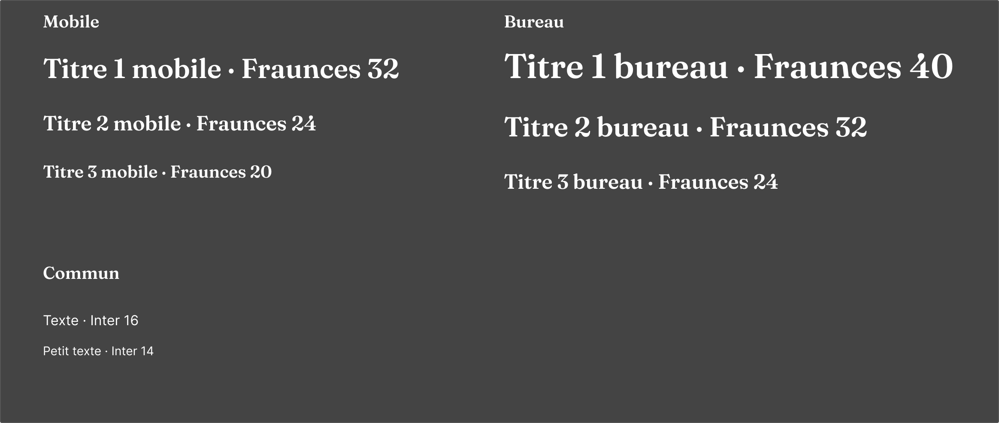

### Choix des polices

**Titres avec empattements, texte sans empattements.** Les empattements évoquent la tradition et le savoir-faire ; ils donnent aux titres un caractère artisanal et gourmand. Le texte sans empattements reste très lisible à l'écran, même en petit sur mobile, dans les formulaires et dans les tableaux : il répond à l'impression « clair, explicite, moderne ». Options écartées : des empattements partout (aspect vieillot, longs formulaires moins confortables sur mobile) et aucun empattement (aspect générique, perte du côté traiteur artisanal).

**Deux polices au maximum**, pour la cohérence visuelle et parce que chaque police est un fichier de plus à télécharger.

| Usage  | Police       | Justification                                                                                                                                                                                                                                                                                                         |
| ------ | ------------ | --------------------------------------------------------------------------------------------------------------------------------------------------------------------------------------------------------------------------------------------------------------------------------------------------------------------- |
| Titres | **Fraunces** | Ses formes rondes et généreuses ont un côté « fait maison », qui correspond à une petite entreprise de deux personnes présentant son savoir-faire. Inspirée de caractères du début du XXᵉ siècle, elle renforce l'aspect traditionnel. Écartées : Lora (plus neutre) et Playfair Display (plus « gastronomie chic »). |
| Texte  | **Inter**    | Conçue pour les écrans et les interfaces : grande hauteur des minuscules, très lisible en petite taille.                                                                                                                                                                                                              |

Les deux polices sont libres (licence SIL Open Font License) : elles peuvent être utilisées dans un projet commercial, hébergées et modifiées.

### Hébergement des polices

Les fichiers des polices seront téléchargés et servis par le serveur du site, et non chargés depuis les serveurs de Google Fonts. Charger une police depuis Google transmet l'adresse IP du visiteur, qui est une donnée personnelle. Le tribunal régional de Munich (20 janvier 2022) a jugé que cette transmission, faite sans consentement, violait le RGPD, puisque l'hébergement local était possible.

### Tailles

Le texte courant est à 16 px, la taille par défaut des navigateurs. Les titres sont plus petits sur mobile que sur ordinateur. La hauteur de ligne est serrée pour les titres, courts et grands, et aérée (150 %) pour les paragraphes. L'espacement des lettres reste celui prévu par les créateurs des polices.

| Style       | Police            | Mobile | Bureau | Hauteur de ligne | Usage                                       |
| ----------- | ----------------- | ------ | ------ | ---------------- | ------------------------------------------- |
| Titre 1     | Fraunces SemiBold | 32 px  | 40 px  | 120 %            | Titre de la page                            |
| Titre 2     | Fraunces SemiBold | 24 px  | 32 px  | 125 %            | Titres de section                           |
| Titre 3     | Fraunces SemiBold | 20 px  | 24 px  | 130 %            | Titre d'une carte de menu, d'un bloc        |
| Texte       | Inter Regular     | 16 px  | 16 px  | 150 %            | Texte courant, champs, boutons              |
| Petit texte | Inter Regular     | 14 px  | 14 px  | 150 %            | Aides sous les champs, mentions, étiquettes |

## Logo

Le client n'a pas fourni de logo, et l'expression du besoin n'en demande pas. Les wireframes prévoyaient pourtant un emplacement pour le logo dans la barre de navigation. Pour ne pas laisser cet emplacement vide, un logo simple a été dessiné. Le client pourra le valider ou le remplacer.

- **Symbole** : une cloche de service, qui évoque le métier de traiteur, et trois étincelles, qui évoquent les événements festifs. Les formes sont simples pour rester lisibles à 32 px. Le symbole est dessiné spécialement, et non pris dans une bibliothèque d'icônes, car un logo doit être propre à l'entreprise. Pistes écartées : une assiette avec des couverts (illisible en petit) et un monogramme « V&G » (illisible en petit, et il ne dit rien du métier).
- **Nom** : « Vite & Gourmand » en Fraunces, la police des titres.
- **Deux versions** : sur fond clair, cloche chocolat et étincelles caramel (`Marque/Accent`) ; sur fond chocolat, tout en crème (`Neutre/Fond`), car le caramel n'y serait pas assez contrasté.
  Le symbole seul servira aussi d'icône d'onglet du navigateur (_favicon_).

## Composants

Chaque composant est enregistré dans Figma comme un composant réutilisable : ses copies suivent automatiquement les modifications du modèle. Dans le code, chacun correspondra à un élément réutilisé sur toutes les pages. La planche sert ainsi de référence pour toutes les pages qui ne sont pas maquettées.

### Boutons

| Bouton               | Fond              | Texte             | Contour                                |
| -------------------- | ----------------- | ----------------- | -------------------------------------- |
| Principal            | Marque/Principale | Neutre/Blanc      | —                                      |
| Principal, survol    | Marque/Chocolat   | Neutre/Blanc      | —                                      |
| Principal, focus     | Marque/Principale | Neutre/Blanc      | Neutre/Texte, 3 px, à l'extérieur      |
| Principal, désactivé | Neutre/Bordure    | Neutre/Blanc      | —                                      |
| Secondaire           | transparent       | Marque/Principale | Marque/Principale, 2 px, à l'intérieur |
| Secondaire, survol   | Marque/Chocolat   | Neutre/Blanc      | Marque/Chocolat, 2 px, à l'intérieur   |

- **Taille** : 48 px de haut (texte de 24 px et marges de 12 px), confortable au doigt sur mobile ; rayon d'angle de 8 px. Le contour du bouton secondaire est placé à l'intérieur, pour qu'il garde la même hauteur que le bouton principal.
- **Hiérarchie** : un seul bouton principal par écran, pour l'action attendue (« Commander », « Suivant »). Le bouton secondaire sert aux actions de retour ou d'annulation (« Retour », « Réinitialiser les filtres »).
- **Survol du bouton secondaire** : un simple changement de couleur du contour et du texte était trop discret. Le bouton se remplit de chocolat, et son texte devient blanc. Le changement est animé en deux temps : le contour passe au chocolat (environ 0,1 s), puis le fond se remplit et le texte devient blanc au même moment (environ 0,15 s). L'animation dure moins de 0,3 s, sinon le bouton paraîtrait lent. Elle est supprimée pour les personnes qui ont demandé à réduire les animations dans leur système (`prefers-reduced-motion`) : elles voient directement l'état final.
- **Focus : une règle unique pour tout le site.** Le survol concerne la souris ; le focus concerne la navigation au clavier (touche Tab), utilisée par les personnes qui n'ont pas de souris ou qui utilisent un lecteur d'écran. Tout élément cliquable (bouton, lien, champ) reçoit au focus un contour `Neutre/Texte` de 3 px à l'extérieur, contrasté à 13,47:1 sur le fond crème. Le bouton principal en sert d'exemple sur la planche.
- **Bouton désactivé** : il sert au bouton « Commander » de la vue détaillée d'un menu épuisé. Il est toujours accompagné d'une phrase qui explique pourquoi (« Ce menu est épuisé. »), car un bouton grisé ne dit pas pourquoi on ne peut pas cliquer. La phrase ne fait pas partie du composant : le bouton désactivé peut servir ailleurs avec une autre explication.

### Étiquettes

Les étiquettes affichent le thème et le régime d'un menu (« Noël », « Végétarien »), c'est-à-dire les critères des filtres : le visiteur voit pourquoi un menu apparaît dans la liste. Texte `Commun/Petit texte` en `Marque/Secondaire texte` sur `Marque/Secondaire fond`.

Leur forme de pilule (angles entièrement arrondis) les distingue des boutons (angles de 8 px) : une étiquette informe, elle ne se clique pas.

Deux variantes :

- **« Épuisé »** aux couleurs `État/Alerte`, placée en premier : le visiteur doit la voir avant de choisir ce menu ;
- **« Menu plus proposé »** (avis portant sur un menu archivé) en couleurs neutres (`Neutre/Texte secondaire` sur `Neutre/Fond`) : c'est une information, pas un problème.

### Champs de formulaire

Un champ réunit toujours son libellé et sa zone de saisie, car l'un n'existe jamais sans l'autre.

- Libellé en `Commun/Texte`, **toujours visible au-dessus du champ**. Un texte d'exemple placé dans le champ disparaît dès qu'on commence à écrire ; il ne peut pas remplacer le libellé.
- Zone de saisie : fond `Neutre/Surface`, contour `Neutre/Bordure` de 1 px, rayon de 8 px, 48 px de haut. Un exemple de saisie (« Ex : 12 ») s'affiche en `Neutre/Texte secondaire`, pour le distinguer d'une vraie valeur.
- Aide éventuelle sous le champ, en `Commun/Petit texte` et `Neutre/Texte secondaire` (« Minimum : 6 personnes pour ce menu. »).
- **En erreur** : contour `État/Erreur texte` de 2 px et message sous le champ. Le message commence par « Erreur : » et indique comment corriger (« Erreur : saisissez une adresse mail complète, par exemple nom@exemple.fr »). L'erreur n'est donc jamais signalée par la seule couleur.

### Alertes et encadré d'information

| Composant           | Exemple                                                                                | Couleurs                        |
| ------------------- | -------------------------------------------------------------------------------------- | ------------------------------- |
| Alerte/Succès       | « Succès : votre commande a bien été enregistrée. »                                    | État/Succès                     |
| Alerte/Erreur       | « Erreur : la commande n'a pas pu être enregistrée. Réessayez dans quelques minutes. » | État/Erreur                     |
| Alerte/Attention    | « Attention : ce menu doit être commandé au moins 7 jours avant la prestation. »       | État/Alerte                     |
| Encadré/Information | « Bon à savoir : −10 % sur le menu dès 11 personnes. »                                 | Marque/Secondaire fond et texte |

Chaque message commence par son type (« Succès : », « Erreur : », « Attention : », « Bon à savoir : ») : le sens ne dépend pas de la couleur. L'encadré d'information a été ajouté pendant la réalisation des mockups. Il présente une information utile au client (réduction, frais de livraison), qui n'est ni une erreur ni un avertissement ; il reprend donc le vert sauge plutôt qu'une couleur d'état.

### Cartes de menu

Le contenu de la carte suit la liste des menus de l'expression du besoin : image principale, titre, description, nombre minimum de personnes et prix correspondant, bouton vers la vue détaillée. Les étiquettes de thème et de régime y ont été ajoutées.

- Fond `Neutre/Surface`, angles de 12 px ; titre en Titre 3 ; description en `Neutre/Texte secondaire` ; bouton principal « Voir le menu » sur toute la largeur de la carte, pratique au doigt.
- **Une seule carte pour mobile et ordinateur** : une carte par ligne sur mobile, trois par ligne sur ordinateur. C'est la disposition de la page qui change, pas la carte.
- **Menu épuisé** : la carte reste affichée, avec l'étiquette « Épuisé » en premier. Le bouton « Voir le menu » reste actif, car la vue détaillée d'un menu épuisé reste consultable ; c'est le bouton « Commander » de la vue détaillée qui est désactivé.

### Tableau

Le tableau de la planche représente la liste des commandes de l'espace employé : date et heure de la prestation, client, menu, nombre de personnes, statut, et un lien « Voir » vers le détail. Il couvre ainsi les écrans de l'espace employé, qui ne sont pas maquettés.

- En-tête chocolat et texte blanc (10,09:1) : les en-têtes sont clairement identifiables.
- Lignes en `Neutre/Surface`, séparées par un trait fin `Neutre/Bordure`.
- Lien « Voir » en `Marque/Principale`, souligné, pour être reconnu comme un lien sans dépendre de la couleur.

## Accessibilité

Le site doit être accessible conformément au RGAA. Pour les couleurs, le RGAA reprend les seuils de contraste des WCAG : **4,5:1** pour le texte et **3:1** pour les éléments graphiques utiles à la compréhension (bordures de champs, icônes, indicateur de focus).

Les contrastes ont d'abord été calculés avec la formule des WCAG, puis vérifiés avec l'extension Figma **A11y - Color Contrast Checker** et avec **WebAIM Contrast Checker**. En cas d'écart, WebAIM fait référence : Figma arrondit les valeurs.

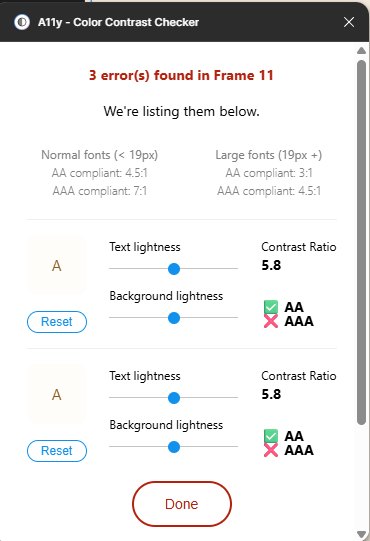

Tous les textes atteignent au moins le niveau AA, et la plupart le niveau AAA (7:1). Les trois signalements de l'extension concernent les liens « Voir » du tableau, à 5,8:1 : ils respectent le niveau AA, mais pas le AAA.

| Combinaison                                           | Contraste                | Niveau          |
| ----------------------------------------------------- | ------------------------ | --------------- |
| Texte principal sur fond crème / sur surface          | 13,47:1 / 15,63:1        | AAA             |
| Texte secondaire sur fond crème / sur surface         | 7,53:1 / 8,74:1          | AAA             |
| Texte blanc sur bouton principal                      | 5,90:1                   | AA              |
| Texte blanc sur chocolat (survol, en-tête de tableau) | 10,09:1                  | AAA             |
| Texte crème sur chocolat (navigation, pied de page)   | 8,55:1                   | AAA             |
| Lien caramel sur fond crème / sur surface             | 5,00:1 / 5,80:1          | AA              |
| Étiquette vert sauge                                  | 6,79:1                   | AA              |
| Succès / Erreur / Alerte                              | 5,14:1 / 5,07:1 / 6,60:1 | AA              |
| Message d'erreur sous un champ                        | 7,24:1                   | AAA             |
| Bordure des champs sur surface (graphique)            | 4,05:1                   | supérieur à 3:1 |
| Étoiles des avis sur fond crème (graphique)           | 3,46:1                   | supérieur à 3:1 |
| Contour de focus sur fond crème (graphique)           | 13,47:1                  | supérieur à 3:1 |

L'extension ne mesure pas un texte posé sur un fond transparent, comme celui du bouton secondaire. Ce contraste a été vérifié avec WebAIM :

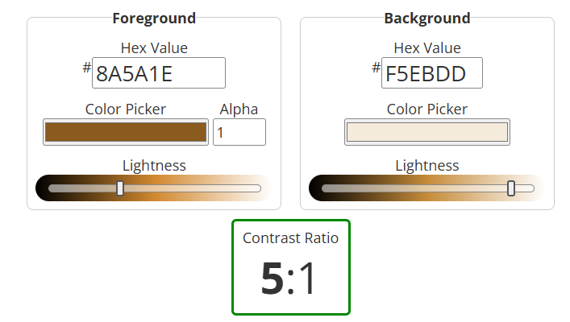

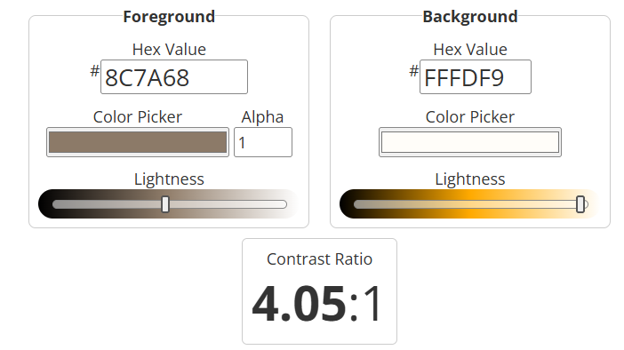

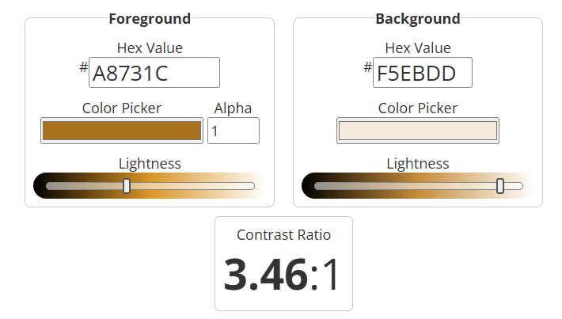

**Texte sur la photo du hero.** Un texte blanc posé directement sur une photo n'a pas de contraste garanti : il dépend des zones claires de l'image. Un voile brun foncé (`#2E1F14` à 70 %) est donc posé entre la photo et le texte. Le contraste a été mesuré sur le pixel le plus clair situé sous le texte :

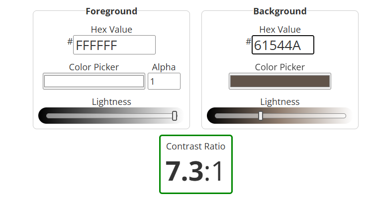

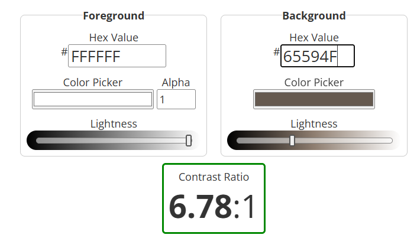

**Autres règles appliquées dans toute la charte :**

- une information n'est jamais transmise par la couleur seule : mots « Erreur : », « Succès : », « Attention : », « Épuisé » ; note des avis écrite (« 4/5 ») à côté des étoiles ; étapes de la commande indiquées par un texte (« Étape 1 sur 3 ») en plus de la barre de progression, dont les segments sont pleins ou vides ;
- liens soulignés dans le texte ;
- libellés de champ toujours visibles ;
- contour de focus visible sur tout élément cliquable ;
- boutons et champs de 48 px de haut ;
- bouton désactivé toujours accompagné d'une explication ;
- montants jamais séparés de leur symbole « € » (espace insécable).

## Wireframes

Un wireframe fixe la structure et le contenu d'un écran, pas son apparence. Il permet de faire valider l'organisation des pages avant de travailler les couleurs et les polices.

**Conventions :**

- gris uniquement, sans les couleurs ni les polices de la charte ;
- chaque bloc est étiqueté (titres, libellés, annotations entre crochets), pour que le contenu se vérifie par rapport aux user stories ;
- largeur de 390 px sur mobile et de 1440 px sur ordinateur (contenu dans 1200 px) ;
- icônes Bootstrap Icons, la bibliothèque officielle de Bootstrap retenu pour le site : les maquettes utilisent les mêmes icônes que le code ;
- même contenu sur mobile et sur ordinateur, seule la disposition change ;
- exemples de données cohérents entre eux (montants qui se recalculent juste, cartes compatibles avec les filtres affichés).
  Des écrans complémentaires montrent des états que la page seule ne montre pas : menu de navigation ouvert, aucun menu ne correspondant aux filtres, étapes 2 et 3 de la commande.

### Page d'accueil

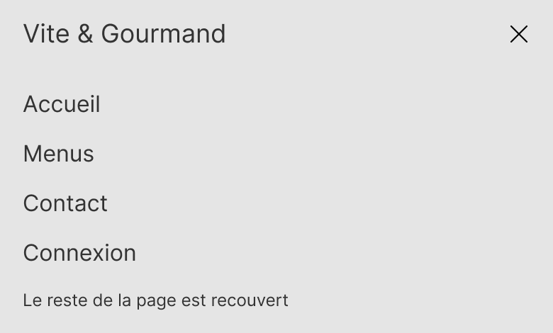

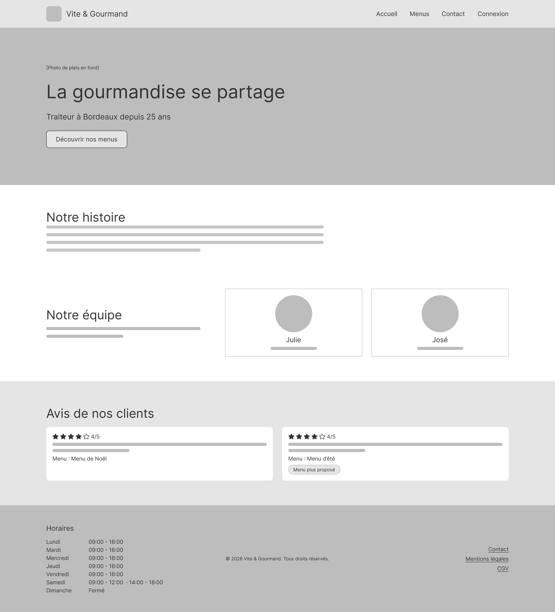

- **Hero ajouté** (choix d'ergonomie) : le visiteur vient pour commander un repas, pas pour lire l'histoire de l'entreprise. Une grande photo, une promesse (« La gourmandise se partage ») et un bouton « Découvrir nos menus » le retiennent et le guident vers les menus. Le titre reprend la valeur « gourmandise » de la charte plutôt que de répéter le nom, déjà présent dans la barre.
- **Ordre de la page** : le hero retient, la présentation et l'équipe rassurent, les avis confirment.
- **Équipe** : l'expression du besoin ne donne ni le rôle ni le parcours de Julie et José ; les emplacements sont prévus et les textes seront fournis par le client.
- **Avis** : note en étoiles accompagnée du texte « 4/5 », sans nom du client (RGPD), avec le menu concerné et l'étiquette « Menu plus proposé » si ce menu a été archivé.
- **Navigation** : menu repliable sur mobile (quatre liens ne tiennent pas sur la largeur), liens en ligne sur ordinateur.
- **Pied de page** : horaires des sept jours (deux plages possibles par jour, ou « Fermé ») et liens Contact, Mentions légales et CGV. Le pied de page propose un lien « Contact » sans coordonnées : un seul chemin de contact (le formulaire), et pas d'adresse mail récupérée par les robots de spam.

### Page des menus

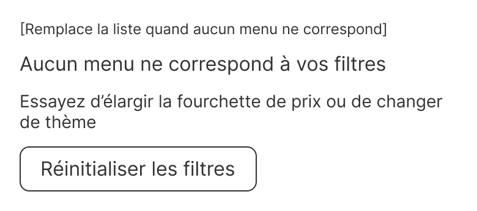

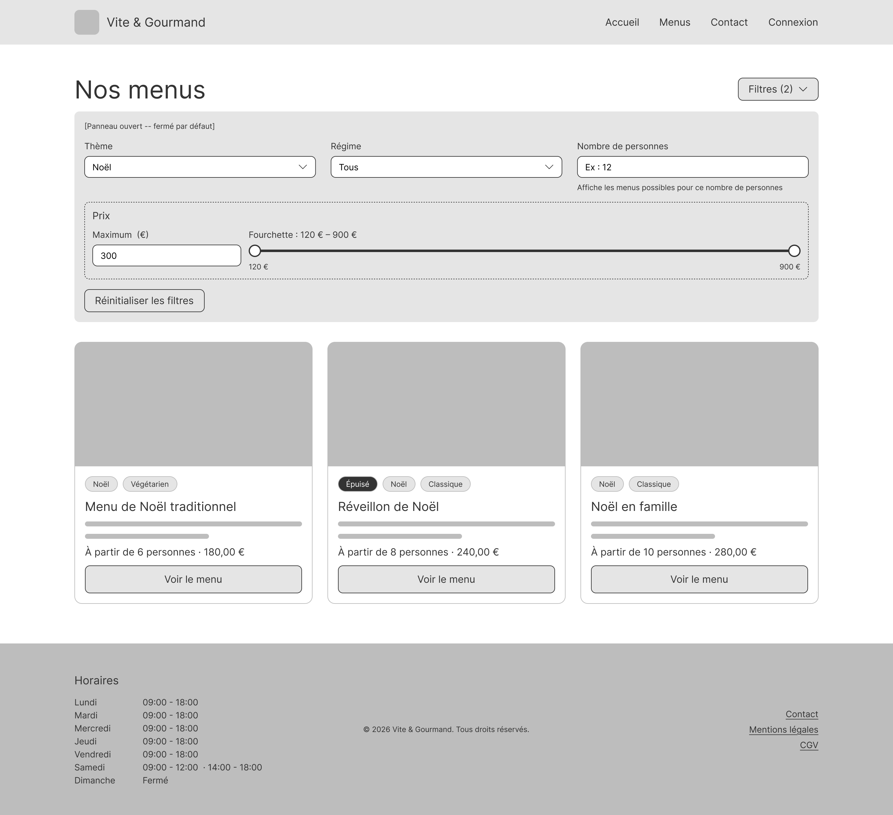

- **Pas de champ de recherche** : l'expression du besoin demande cinq filtres, pas une recherche par mots.
- **Filtres repliables** derrière un bouton « Filtres (2) », fermés par défaut, sur mobile comme sur ordinateur. Le chiffre indique le nombre de filtres actifs. Sur ordinateur, une colonne de filtres permanente a été écartée : elle donnait un air de catalogue, alors que les photos des menus doivent occuper la scène.
- **Organisation du panneau** : thème et régime côte à côte, nombre de personnes (avec une aide qui explique ce que fait ce filtre), puis un groupe « Prix » réunissant le prix maximum et la fourchette. Les deux filtres de prix sont exigés ; le prix maximum reste pratique pour taper directement un budget.
- **Fourchette de prix** : curseur à deux poignées avec les valeurs affichées ; les bornes sont le prix du menu le moins cher et celui du plus cher.
- **Cartes** : une par ligne sur mobile, trois sur ordinateur ; un menu épuisé reste affiché avec l'étiquette « Épuisé ».

### Formulaire de commande

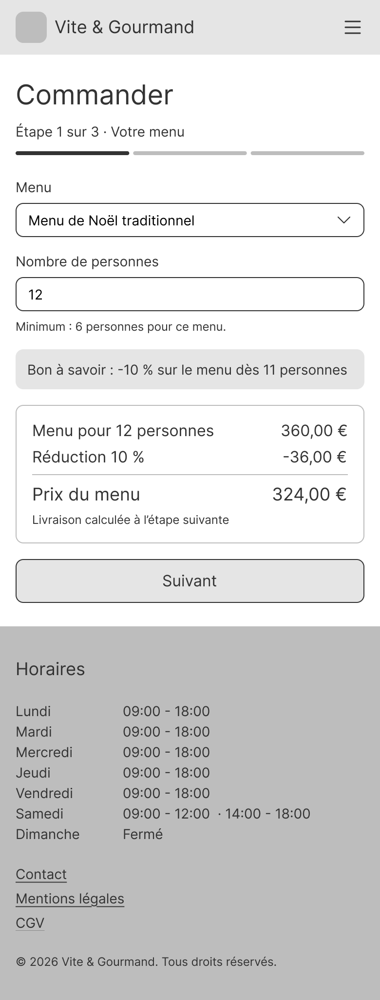

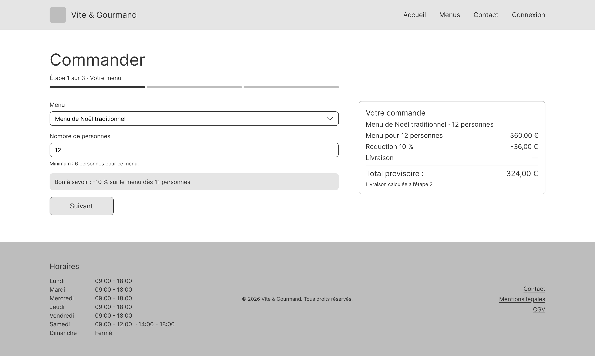

- **Trois étapes** (Votre menu, Livraison, Récapitulatif), avec le texte « Étape X sur 3 » et une barre de progression : le formulaire est trop long pour une seule page sur mobile. Le menu vient en premier, puisque le client arrive du bouton « Commander » d'un menu ; ses coordonnées, préremplies depuis son compte, sont vérifiées à la fin.
- **Adresse en trois champs** (numéro et rue, code postal, ville), comme dans le modèle de données, avec des propositions d'adresses pendant la saisie et un bouton « Utiliser l'adresse de mon compte ».
- **Aides et encadrés** : minimum de personnes, condition de réduction, délai de commande du menu, frais de livraison.
- **Sur ordinateur** : formulaire à gauche et récapitulatif du prix toujours visible à droite, mis à jour à chaque changement. Seule l'étape 1 est dessinée : les étapes 2 et 3 suivent la même disposition, et leur contenu est déjà détaillé dans les maquettes mobiles.

## Mockups

Les mockups montrent le rendu final : la structure des wireframes, habillée avec les couleurs, les polices et les composants de la charte. Ils ont été réalisés d'abord pour le mobile, puis pour l'ordinateur, en reprenant les mêmes décisions : le site garde la même identité sur les deux supports.

**Éléments communs :**

- **Navigation** : fond chocolat, logo en version fond foncé (même taille sur mobile et sur ordinateur), liens en crème. Dans la barre de navigation, les liens ne sont pas soulignés : le contexte suffit à les reconnaître.
- **Pied de page** : fond chocolat, textes crème, liens soulignés.
- **Fond des pages** : `Neutre/Fond` (crème).

### Page d'accueil

![Mockup mobile de la page d'accueil : barre de navigation chocolat avec le logo crème et le bouton menu ; hero avec la photo d'une table de Noël assombrie par un voile brun, le titre blanc « La gourmandise se partage », l'accroche « Traiteur à Bordeaux depuis 25 ans » et le bouton caramel « Découvrir nos menus » ; « Notre histoire » ; « Notre équipe » avec les fiches de Julie (Logistique et livraison) et de José (Cuisine), photos rondes ; deux avis avec étoiles caramel et note « 4/5 », dont un avec l'étiquette neutre « Menu plus proposé » ; pied de page chocolat avec les horaires et les liens soulignés.](images/charte-graphique/mockup-accueil-mobile.png)

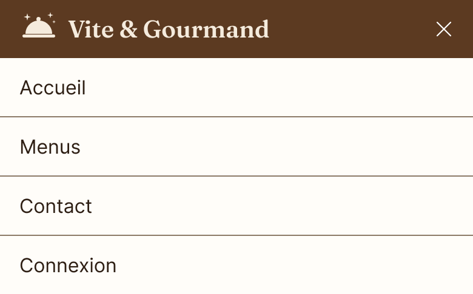

- **Hero** : voile brun foncé à 70 % sur la photo, pour garantir la lisibilité du texte blanc (voir la partie Accessibilité).
- **Textes de présentation** : ils reprennent uniquement les informations de l'expression du besoin (25 ans, Bordeaux, Julie et José, tous les événements), sans promesse que le client n'a pas faite.
- **Fiches de l'équipe** : fond `Neutre/Surface`, photo ronde, prénom et rôle.
- **Avis** : cartes sans contour, étoiles caramel et note écrite ; l'étiquette « Menu plus proposé » est neutre, car le jaune est réservé à « Épuisé ».
- **Menu ouvert** : panneau clair avec des séparateurs entre les liens, chaque lien sur une zone de 48 px de haut. Un grand aplat chocolat aurait été trop lourd : le chocolat est réservé aux bandes.

### Page des menus

![Mockup mobile de la page des menus : titre « Nos menus », bouton secondaire « Filtres (2) », panneau des filtres blanc avec thème « Noël », régime « Tous », nombre de personnes « Ex : 12 », groupe « Prix » avec maximum 300 et curseur caramel à deux poignées, bouton « Réinitialiser les filtres » ; carte « Menu de Noël traditionnel » avec les étiquettes Noël et Végétarien, photo de courges farcies, 6 personnes, 180,00 € ; carte « Réveillon de Noël » avec les étiquettes Épuisé (jaune), Noël et Classique, photo de volaille rôtie, 8 personnes, 240,00 €.](images/charte-graphique/mockup-menus-mobile.png)

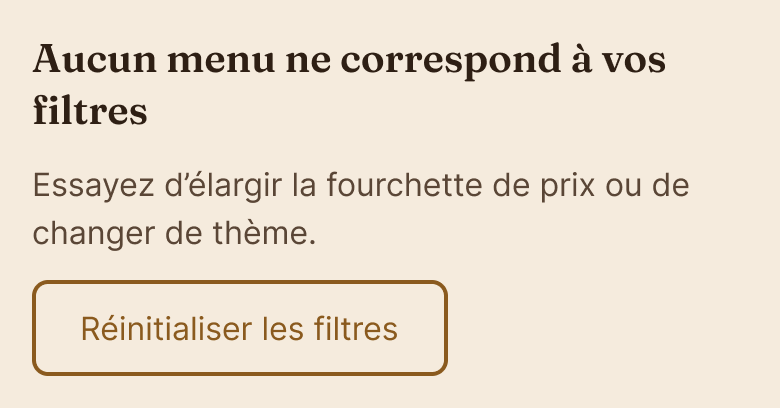

- **Bouton « Filtres (2) »** à l'apparence d'un bouton secondaire : il ouvre un panneau, ce n'est pas l'action principale de la page.
- **Champs** du composant de la charte ; groupe « Prix » entouré d'un contour plein ; curseur à la couleur de la marque pour montrer la plage choisie.
- **Cartes cohérentes avec les filtres affichés** : toutes du thème Noël et à 300 € au plus. Sinon, la maquette donnerait l'impression que les filtres ne fonctionnent pas.
- **Photos cohérentes avec les étiquettes** : un plat sans viande pour le menu végétarien, une volaille et un filet de bœuf pour les menus classiques.

### Formulaire de commande

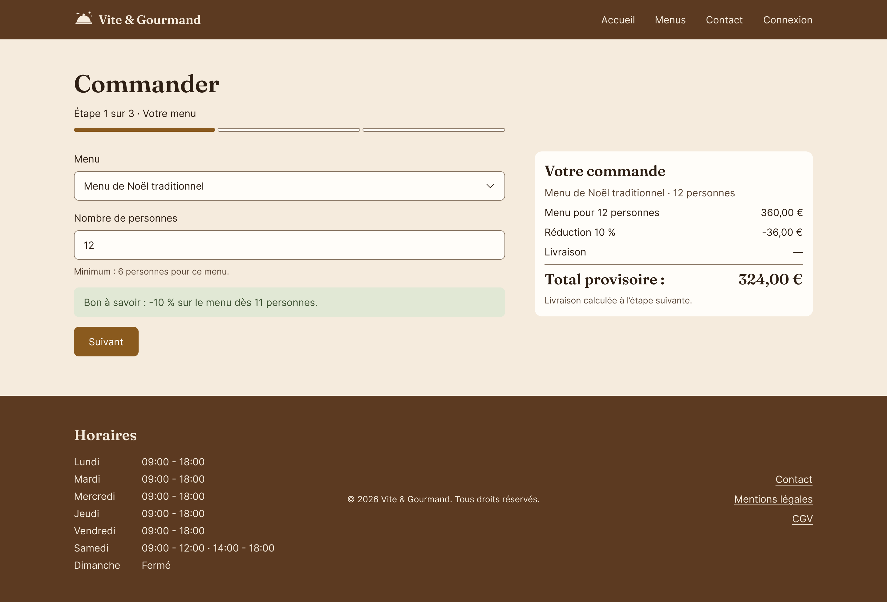

- **Barre de progression** : segments pleins pour les étapes atteintes, vides (contour seul) pour les suivantes. La forme distingue les étapes, pas seulement la couleur.
- **Champs et récapitulatifs** : les champs ont un contour, parce qu'on les remplit ; les récapitulatifs sont des cartes sans contour, parce qu'on les lit.
- **Encadrés « Bon à savoir »** en vert sauge pour la réduction et les frais de livraison.
- **Sur ordinateur** : le bouton « Suivant » prend la largeur de son texte, car on clique à la souris ; le total provisoire est en Titre 3, c'est la ligne la plus importante du récapitulatif.
- **Exemples chiffrés cohérents** : 180,00 € pour 6 personnes, soit 360,00 € pour 12 ; réduction de 10 % dès 11 personnes (−36,00 €) ; livraison à Mérignac, à 20 km : 5 € + 20 × 0,59 € = 16,80 € ; total : 340,80 €.

## Photos et contenus d'illustration

### Photos

Les photos proviennent d'Unsplash, sous licence gratuite : usage commercial autorisé, sans attribution obligatoire. Les photos « Unsplash+ », payantes, ont été écartées. Les crédits seront tout de même indiqués dans les mentions légales du site.

Critères de choix :

- des plats appétissants aux tons chauds, en accord avec la palette ;
- un contenu cohérent avec les étiquettes du menu (un plat sans viande pour un menu végétarien) ;
- aucune bouteille d'alcool mise en avant (loi Évin) ;
- pas de visage sur les photos de plats.
  | Usage | Auteur | Lien |
  |---|---|---|
  | Hero de l'accueil | Jed Owen | https://unsplash.com/fr/photos/pain-brun-sur-assiette-en-ceramique-blanche-EgG6wcsjFtE |
  | Portrait de Julie | Steven Cleghorn | https://unsplash.com/fr/photos/femme-portant-un-tablier-marron-psomVjxL29Y |
  | Portrait de José | Christian Buehner | https://unsplash.com/fr/photos/homme-portant-une-chemise-blanche-et-des-lunettes-souriant-hIbh3VlZgwU |
  | Carte « Menu de Noël traditionnel » | Terry Granger | https://unsplash.com/fr/photos/une-assiette-noire-surmontee-de-trois-glands-farcis-y-wA0IF6K-0 |
  | Carte « Réveillon de Noël » | Anna Jakutajc-Wojtalik | https://unsplash.com/fr/photos/une-assiette-de-nourriture-sur-une-table-en-bois-caq24Ujxm_0 |
  | Carte « Noël en famille » | Jed Owen | https://unsplash.com/fr/photos/pain-sur-assiette-en-ceramique-blanche-a-cote-du-pain-tranche-sur-la-table-q6Y8Xr3SoQA |

La photo du hero et celle de la carte « Noël en famille » viennent du même photographe et de la même table : le hero montre ainsi un vrai menu de la carte.

### Contenus à faire valider par le client

Les maquettes contiennent des contenus d'exemple, qui montrent la mise en page avec des données réalistes. Ils devront être validés ou remplacés par le client :

- les portraits de Julie et José, qui sont des photos d'illustration ;
- le rôle de José (« Cuisine ») ; celui de Julie (« Logistique et livraison ») s'appuie sur l'expression du besoin, qui mentionne « l'équipe logistique de Julie » ;
- les avis des clients et les descriptions des menus ;
- le logo.

## Sources

- Fraunces (auteurs, licence) : https://fonts.google.com/specimen/Fraunces/about
- Inter (auteur, licence) : https://github.com/rsms/inter
- Association de Fraunces et d'Inter : https://madegooddesigns.com/fraunces-font-pairings/
- Vérification des contrastes : https://webaim.org/resources/contrastchecker/
- Décision du tribunal régional de Munich sur Google Fonts (20 janvier 2022) : https://kpmg-law.de/en/?p=25292
- Licence Unsplash : https://unsplash.com/fr/licence
